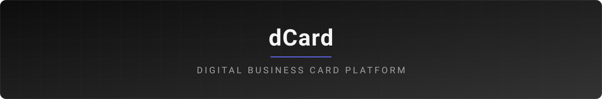

<p align="center">
  
</p>

<p align="center">
  <a href="https://github.com/diogocorreadcs/dCard" target="_blank">
    
  </a>
  <a href="https://nextjs.org" target="_blank">
    
  </a>
  <a href="https://tailwindcss.com" target="_blank">
    
  </a>
  <a href="https://www.typescriptlang.org" target="_blank">
    
  </a>
  <a href="https://www.docker.com" target="_blank">
    
  </a>
  <a href="LICENSE" target="_blank">
    
  </a>
</p>

---

### Sobre o Projeto

O **dCard** é uma plataforma de cartão de visita digital profissional, moderna e altamente interativa construída com Next.js (App Router), Tailwind CSS e TypeScript. Desenvolvido para ser 100% configurável via variáveis de ambiente, ele oferece zero acoplamento de código, suporte a PWA, Web Share API, modo de impressão A4, extração dinâmica de cores e integração com Spotify.

---

### Funcionalidades

- **Configuração Zero-Code:** Totalmente customizável via `.env.local` e modelos prontos na pasta `envs/`.
- **Widgets Interativos:** Integração com o Spotify (música, álbum ou podcast) e contador de visitas locais (`localStorage`).
- **Recursos de Compartilhamento:** Botões para Web Share API, QR Code dinâmico e visualização em grade pronta para impressão (A4 Print View).
- **Design Adaptativo:** Suporte a temas claro/escuro e extração dinâmica de cores de destaque com base no avatar.

---

### 🚀 Instalação e Execução

Siga os passos abaixo para configurar e executar o projeto em seu ambiente local:

#### 1. Clonar o Repositório
```bash
git clone https://github.com/diogocorreadcs/dCard.git
cd dCard
```

#### 2. Instalar as Dependências
```bash
npm install
```

#### 3. Configurar as Variáveis de Ambiente
Escolha um perfil na pasta `envs/` ou copie o modelo padrão para a raiz como `.env.local`:
```bash
cp envs/.env.full .env.local
```
*(Lembre-se de editar o arquivo `.env.local` com as suas informações pessoais).*

#### 4. Iniciar o Servidor de Desenvolvimento
```bash
npm run dev
```
O projeto estará acessível em `http://localhost:3000`.

#### 5. Executando via Docker (Opcional)
Se preferir rodar utilizando containers:
```bash
docker-compose up --build -d
```

---

### ⚙️ Variáveis de Ambiente Principais

O dCard é controlado inteiramente pelas variáveis configuradas no seu arquivo `.env.local`:

| Variável | Descrição |
| :--- | :--- |
| `NEXT_PUBLIC_CARD_NAME` | Seu nome completo ou de exibição |
| `NEXT_PUBLIC_CARD_ROLE` | Cargo ou profissão principal |
| `NEXT_PUBLIC_CARD_COMPANY` | Empresa ou organização atual |
| `NEXT_PUBLIC_CARD_BIO` | Descrição biográfica profissional |
| `NEXT_PUBLIC_CARD_LOCATION` | Localização geográfica (Cidade/País) |
| `NEXT_PUBLIC_CARD_PHONE` | Número para contato direto / WhatsApp |
| `NEXT_PUBLIC_CARD_EMAIL` | E-mail profissional principal |
| `NEXT_PUBLIC_CARD_SPOTIFY_URL` | Link do Spotify para o widget integrado |
| `NEXT_PUBLIC_CARD_PROJECTS` | Lista de projetos em formato JSON |
| `NEXT_PUBLIC_CARD_LINKS` | Lista de redes sociais em formato JSON |

---

### 🤝 Contribuição e Licença

Este é um projeto **Open Source** distribuído sob a licença **MIT**. 

Sinta-se à vontade para:
- Abrir *issues* para relatar bugs ou sugerir melhorias.
- Enviar *Pull Requests* com novas funcionalidades, correções ou otimizações.

Sua contribuição é sempre muito bem-vinda!
