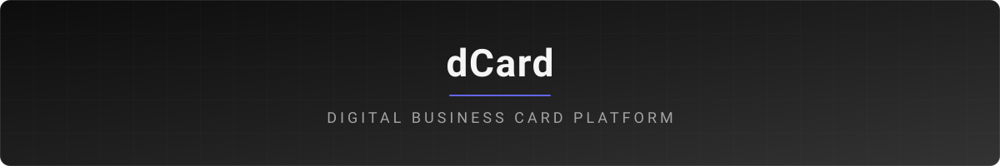

  

  
  
  
  
  
  

---

### Sobre o Projeto

O **dCard** é uma plataforma de cartão de visita digital profissional, moderna e altamente interativa construída com Next.js (App Router), Tailwind CSS e TypeScript. Desenvolvido para ser 100% configurável via variáveis de ambiente, ele oferece zero acoplamento de código, suporte a PWA, Web Share API, modo de impressão A4, extração dinâmica de cores e integração com Spotify.
